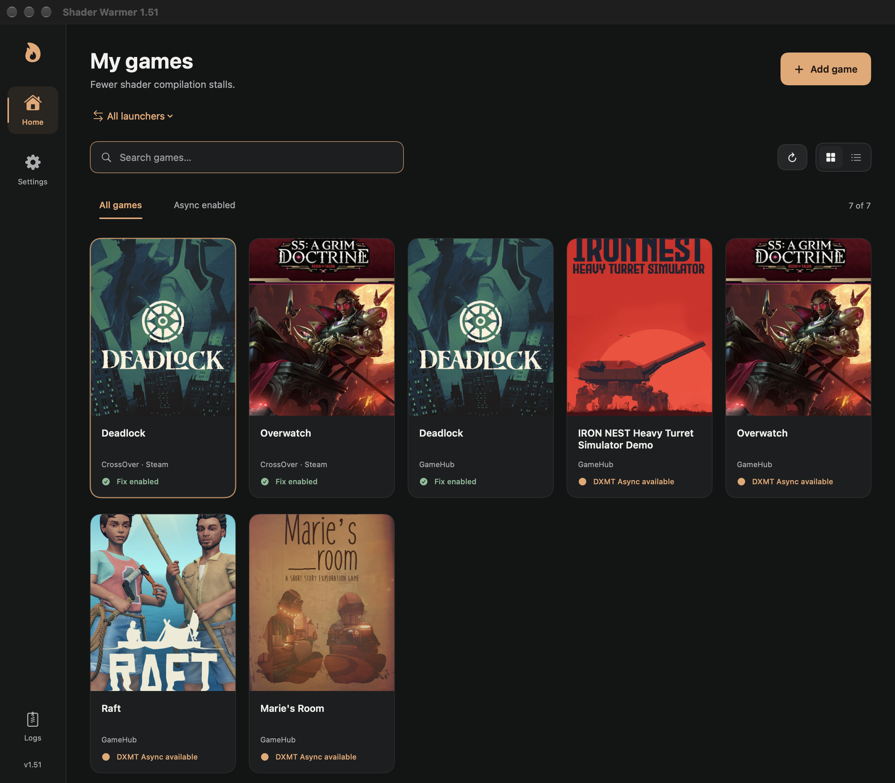
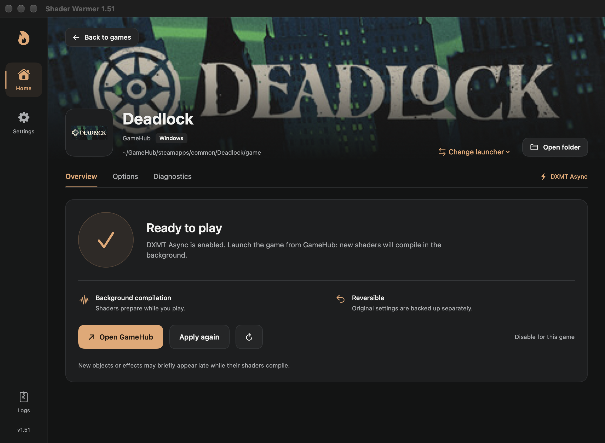
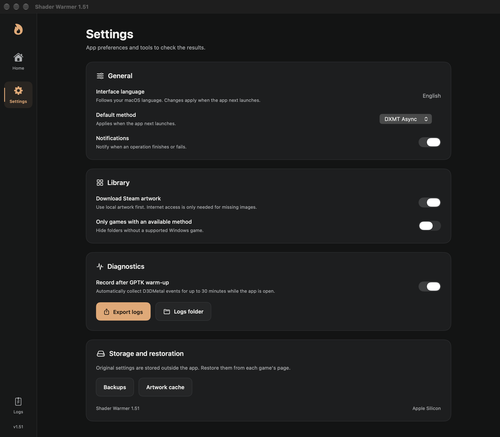

# Shader Warmer

**Reduce shader compilation stalls in Windows games on Apple Silicon.**

[Русский](README.ru.md) · [Download](../../releases) · [Compatibility](docs/COMPATIBILITY.md)

Shader Warmer enables a patched **DXMT Async** build for compatible **DirectX 11 x64** games. It combines background graphics pipeline compilation with earlier shader preparation to reduce first-use stalls.

When a graphics pipeline is still compiling, the patch can skip its draw rather than wait for completion. Objects or effects may briefly appear late. This trade-off needs visual testing in each game; it is not a universal fix or a guaranteed increase in average FPS.

## Screenshots

English interface · Shader Warmer 1.51.



<table>
  <tr>
    <th>Game overview</th>
    <th>Settings</th>
  </tr>
  <tr>
    <td width="50%" valign="top"><a href="docs/screenshots/game-en.png"></a></td>
    <td width="50%" valign="top"><a href="docs/screenshots/settings-en.png"></a></td>
  </tr>
</table>

## Interface language

The app automatically follows your macOS preferred languages: **English or Russian**. Regional variants are supported. If neither language is in your preferred list, it uses English. Restart the app after changing macOS language preferences.

## Requirements

- Apple Silicon Mac, **macOS 15+**, Rosetta 2 for DXMT Async.
- Installed Windows x64 game running in **DirectX 11** mode and compatible with DXMT.
- GameHub: **Wine Proton 11 x64**, **DXMT v0.80**, initialized game container.
- CrossOver or other Wine environments: compatible installed runtime. The app checks the Async DLL and D3D11 device creation before activation.

The UI supports macOS 14+, but Async requires macOS 15+. The downloaded app includes Python and native helpers; users do not need Homebrew, Python or Xcode.

## Install and use

1. Download `DeadlockWarmer.dmg` from [Releases](../../releases) and drag **Shader Warmer** to Applications.
2. The app is not Apple-notarized. If macOS blocks a trusted downloaded copy, remove its quarantine attribute once after installation:

   ```sh
   xattr -dr com.apple.quarantine "/Applications/Shader Warmer.app"
   ```

3. Close the game and Windows apps in its environment. Select the game and launcher in Shader Warmer, choose **DXMT Async**, then **Enable fix**.
4. Keep the game in DX11 mode. Launch normally from GameHub or CrossOver/Steam; Shader Warmer can be closed. Other connected Wine environments use the launch action in Shader Warmer.

Use the disable action to restore managed settings. CrossOver activation affects the **entire bottle**. Keep `~/Library/Application Support/ShaderWarmer/` while Async is enabled; disable it before deleting its backups/private runtimes. Game files are not patched.

## Release scope

Version **1.51** is an early public release. Manual Deadlock testing received positive smoothness feedback, but a controlled quantitative benefit has not been established for this build. No acceleration percentage or complete stutter elimination is claimed.

This method does not support DX12-only or 32-bit games. Experimental D3DMetal/DX12 Async research is **not included**. The optional GPTK warmer is a separate existing workflow.

Artwork may be fetched from Steam's public CDN; it can be disabled in settings. Logs and backups are local; diagnostic exports are user initiated. See [privacy](docs/PRIVACY.md), [build instructions](docs/BUILD.md) and [third-party notices](THIRD_PARTY_NOTICES.md).

Our code and changes are MIT-licensed. Built on [DXMT](https://github.com/3Shain/dxmt); its license and our source patches are included.
